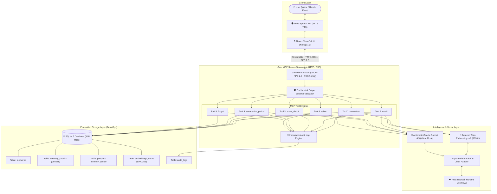

# Griot System Architecture & Design Decisions

This document details the high-level architecture, protocol contracts, data structures, and engineering trade-offs behind **Griot**, the open-source conversational episodic memory layer for Alexa+.

---

## 1. High-Level System Architecture



---

## 2. Core Design Decisions

### A. Model Context Protocol (MCP) with Streamable HTTP
- **Decision:** Use the official Model Context Protocol (MCP) spec with Streamable HTTP (`POST /mcp`) and Server-Sent Events (`GET /sse`) rather than standard `stdio`.
- **Rationale:** Voice assistants like Alexa+ are distributed cloud or edge devices. A self-hosted HTTP server enables decoupled deployment in Docker containers, AWS ECS, or serverless environments.

### B. SQLite with Binary Vector Storage (Zero-Ops)
- **Decision:** Store normalized vector embeddings directly as binary float32 BLOBs inside SQLite with in-memory Float32Array cosine distance calculation.
- **Rationale:** External vector databases (Pinecone, Qdrant, Weaviate) introduce operational overhead, cloud latency, and configuration friction. SQLite with WAL mode delivers <5ms vector retrieval times for typical personal memory corpuses (<100,000 memories) with zero infrastructure setup.

### C. Recency-Weighted Relevance Reranking
- **Decision:** Score memory retrieval using a composite mathematical formula balancing semantic similarity and temporal decay:
  $$\text{Score} = (1 - \alpha) \cdot \cos(\theta) + \alpha \cdot e^{-\lambda \cdot \Delta t}$$
  where $\lambda = \frac{\ln(2)}{\text{half\_life\_days}}$, default $\alpha = 0.15$, and half-life is 30 days.
- **Rationale:** If a user asks *"Where did I park?"* or *"What did David say?"*, a memory from yesterday is far more contextually relevant than an identical statement from two years ago.

### D. SQLite Deduplication Embedding Cache
- **Decision:** Hash every chunk using SHA-256 and store cached embeddings in the `embeddings_cache` table.
- **Rationale:** Prevents duplicate calls to AWS Bedrock Titan Embeddings v2, significantly reducing API costs and mitigating rate limit throttling.

### E. Voice Persona Conditioning for Claude
- **Decision:** Enforce rigid system instructions capping Claude Sonnet 4.5 outputs to under 30 words, with strict zero-markdown stripping.
- **Rationale:** Text-To-Speech (TTS) synthesizers stumble when reading asterisks, markdown tables, or bulleted lists. Alexa requires natural, direct spoken dialogue.

---

## 3. SQLite Database Schema

```sql
-- Core episodic memory records
CREATE TABLE memories (
  id TEXT PRIMARY KEY,
  content TEXT NOT NULL,
  occurred_at TEXT NOT NULL,
  created_at TEXT NOT NULL,
  updated_at TEXT NOT NULL,
  deleted_at TEXT,
  metadata TEXT NOT NULL DEFAULT '{}'
);

-- Chunked text and vector embeddings
CREATE TABLE memory_chunks (
  id TEXT PRIMARY KEY,
  memory_id TEXT NOT NULL,
  chunk_index INTEGER NOT NULL,
  content TEXT NOT NULL,
  embedding BLOB NOT NULL,
  FOREIGN KEY (memory_id) REFERENCES memories(id) ON DELETE CASCADE
);

-- Hash-keyed embedding cache
CREATE TABLE embeddings_cache (
  content_hash TEXT PRIMARY KEY,
  embedding BLOB NOT NULL,
  model_id TEXT NOT NULL,
  created_at TEXT NOT NULL
);

-- Recognized person entities
CREATE TABLE people (
  id TEXT PRIMARY KEY,
  name TEXT NOT NULL UNIQUE,
  normalized_name TEXT NOT NULL UNIQUE,
  first_seen_at TEXT NOT NULL,
  last_seen_at TEXT NOT NULL
);

-- Junction table
CREATE TABLE memory_people (
  memory_id TEXT NOT NULL,
  person_id TEXT NOT NULL,
  PRIMARY KEY (memory_id, person_id)
);

-- Immutable audit log
CREATE TABLE audit_logs (
  id TEXT PRIMARY KEY,
  action TEXT NOT NULL,
  memory_id TEXT,
  details TEXT NOT NULL,
  created_at TEXT NOT NULL
);
```

---

## 4. MCP Tool Specifications

| Tool Name | Input Parameters | Key Output Fields | Primary Voice Use Case |
| :--- | :--- | :--- | :--- |
| **`remember`** | `content`, `tags?`, `people?`, `occurred_at?` | `id`, `message` | *"Alexa, remember that Mom loves chamomile tea."* |
| **`recall`** | `query`, `limit?`, `person?`, `since?` | `results`, `spoken` | *"Alexa, what is David allergic to?"* |
| **`know_about`** | `person` | `person`, `summary`, `facts`, `last_mentioned` | *"Alexa, what do you know about Sarah?"* |
| **`summarize_period`** | `period`, `anchor_date?` | `period`, `summary`, `memory_count` | *"Alexa, summarize what happened this week."* |
| **`forget`** | `query?`, `person?`, `all?` | `deleted_count`, `message` | *"Alexa, forget everything about Alex."* |
| **`reflect`** | `date?` | `date`, `reflection`, `highlights`, `questions` | Proactive morning or evening reflection briefing. |

---

## 5. Security & Privacy Model

- **Least-Privilege AWS IAM:** Griot requires only `bedrock:InvokeModel` permissions on two specific ARNs:
  - `arn:aws:bedrock:*::foundation-model/amazon.titan-embed-text-v2:0`
  - `arn:aws:bedrock:*::foundation-model/anthropic.claude-sonnet-4-5-20250929-v1:0`
- **Zero-Telemetry:** All memories remain strictly inside the local SQLite database container. No user data is transmitted to third-party tracking services.
- **Auditable Deletions:** When memories are forgotten, records are soft-deleted and an entry is added to `audit_logs` tracking timestamp and scope.
